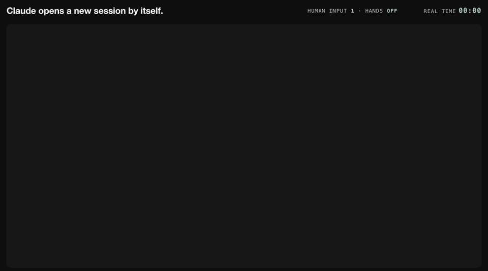
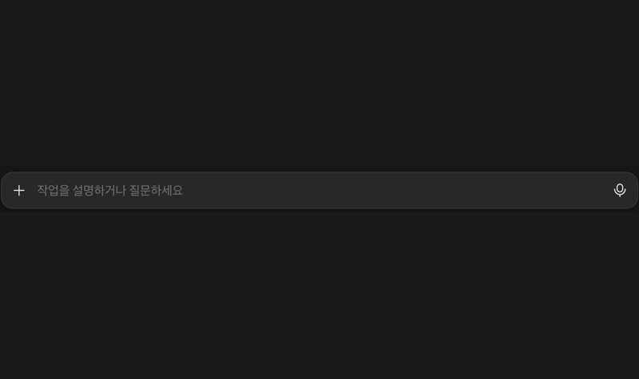
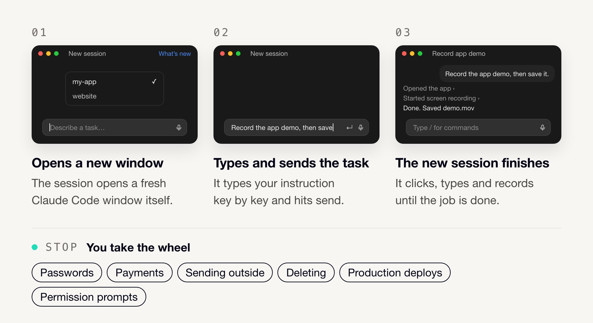

# 셀프 드라이빙 (self-driving): Claude Code 스킬

[English](README.md) | **한국어**



> **라이선스: CC BY-NC 4.0 (비상업적 이용만).** 출처를 밝히면 개인·비영리 목적으로 쓰고 고치고 나눌 수 있습니다. 판매·유료 서비스 등 상업적 이용은 할 수 없습니다.

사람은 「무엇을 해 달라」만 말하고, Claude Code 세션이 맥 화면을 직접 조작해(앱 열기·클릭·입력·녹화·빌드·시험) 일을 끝내게 하는 작업 방식입니다. 자동 안전 검사, OS 권한 창, 비밀번호, 결제, 외부 발송처럼 사람이 해야 하는 순간에만 멈추고 알려 줍니다.


## 컴퓨터 유즈·브라우저 유즈와 무엇이 다른가
컴퓨터 유즈(computer use)와 브라우저 유즈(browser use)는 **도구**입니다. 이 도구만으로도 Claude Code 세션은 셸과 함께 지시 하나로 화면 작업 여러 단계를 이어 갈 수 있습니다. 셀프 드라이빙은 그 위에 올린 **일하는 방식**이고, 세 가지를 더합니다.

| | 컴퓨터 유즈·브라우저 유즈만 | 셀프 드라이빙을 쓰면 |
|---|---|---|
| 새 Claude 세션 열기 | 도구가 하는 일이 아님 | 세션이 스스로 새 Claude 세션 창을 열고 지시 하나를 보냄(`tools/drive`) |
| 어디서 멈추나 | 지시에 적은 대로 | 정해진 멈추는 곳 목록(아래 「보안」)과 `deny` 규칙 |
| 녹화·결과 모으기 | 지시에 적은 대로 | 정해진 순서: 한 세션만 화면을 잡고(잠금 파일), 녹화를 정리하고, 결과를 한 폴더에 모으고, 막힌 것을 보고 |

## 무엇을 혼자 할 수 있나
셀프 드라이빙을 쓰면 Claude Code가 원래 할 수 있는 일을, 멈추는 곳을 빼고는 사람 손 없이 끝까지 합니다. 앱 만들기(코드 작성·빌드·시험), 컴퓨터 유즈·브라우저 유즈로 앱과 브라우저 조작, 시연 영상 화면 녹화, 새 세션에 일 나눠 주기가 여기에 들어갑니다.
- **실제로 해 본 것(맨 위 데모):** macOS의 Claude 데스크톱 앱에서, 아래 「처음 써 보기」 지시 한 번으로 세션 하나가 할 일 웹앱을 만들고, 맥·휴대폰 크기에서 브라우저 시험 26개를 모두 통과하고, 30초 시연 영상을 녹화하고, 시험 보고서까지 썼습니다. 그 뒤 사람 입력은 없었고, 실제로 약 15분 걸렸습니다.
- **실제로 해 본 것:** 세션이 스스로 새 세션 창을 열고 입력칸에 지시를 입력해 보냈고, 새 세션이 답했습니다.



## 이런 때 씁니다
- 앱 시연 화면을 처음부터 끝까지 녹화하게 할 때
- 다른 맥(운전 맥)에서 기능 개발·시험·화면 확인까지 맡길 때
- 자리를 비운 동안 지금 쓰는 맥에서 정해 둔 일을 하게 할 때(부재중 표시 파일이 있을 때만)

## 필요한 것
| 필요한 것 | 왜 | 확인 방법 |
|---|---|---|
| macOS 14 이상 + Claude 데스크톱 앱의 Claude Code | 스킬과 세션이 도는 곳 | 앱의 Code 탭에서 세션이 열리는지 |
| Pro·Max·Ultra 요금제 | 컴퓨터 유즈는 이 요금제에서 되고, Team·Enterprise에서는 안 됩니다 | 앱 로그인 상태 |
| 화면 조작(computer use) 켜짐 | 앱 열기·클릭·입력 | 세션에서 화면 조작 도구가 보이는지. 앱별로 처음 쓸 때 허용 창이 뜹니다 |
| macOS 「화면 기록」·「손쉬운 사용」 권한 | 화면 보기·조작·녹화 | 시스템 설정 → 개인정보 보호 및 보안 |
| (두 대로 쓸 때) 세션 간 메시지 | 지휘 세션 → 운전 맥 세션 지시 | `ListAgents`에 상대 세션이 보이거나, 상대가 Remote Control로 켜져 있는지 |
| (두 대로 쓸 때) ssh 접속 | 운전 맥의 파일·프로세스 확인, 결과 가져오기 | `ssh <driver_ssh> true`가 비밀번호 없이 되는지 |
| (녹화할 때) 녹화 앱 | 시연 녹화 | 아무 녹화 앱. 끝나면 프로세스를 끌 수 있어야 합니다 |
| (Claude 앱 창을 조작할 때) Xcode 명령줄 도구 | `tools/drive` 빌드 | `swiftc --version`이 되는지. 없으면 `xcode-select --install` |

한 대로만 써도 됩니다. 그때는 `driver_ssh`를 비워 두고, 지금 세션이 바로 운전합니다.

## 지원 범위
| 환경 | 상태 |
|---|---|
| macOS + Claude 데스크톱 앱(Code 탭) | **지원.** 기본 환경이고, 시험한 환경은 이것뿐입니다. |
| 터미널 Claude Code(macOS) | **새 세션 시작은 지원**합니다. 아래 `tools/spawn`으로 하고, 헤드리스 모드는 macOS에서 시험했습니다. `--visible`은 시험하지 않았습니다. 터미널에서도 컴퓨터 유즈를 쓸 수 있지만(연구 미리보기: `/mcp`에서 내장 서버 `computer-use`를 켬, 프로젝트마다 한 번, `-p` 모드에서는 안 됨), 터미널에서 셀프 드라이빙 전 과정을 돌려 보지는 않았습니다. |
| Linux의 터미널 Claude Code | 시험 안 함. `tools/spawn` 헤드리스 모드는 `bash`·`uuidgen`·`claude`만 써서 되도록 설계했습니다. `--visible`과 `tools/drive`는 macOS 전용입니다. |
| Windows(그리고 Linux의 나머지 기능) | **아직 지원하지 않음.** 컴퓨터 유즈 자체는 데스크톱 앱에서 Windows도 되지만, 이 스킬은 macOS에만 있는 것을 씁니다: `tools/drive`(Swift·CGEvent·손쉬운 사용 API), `osascript`, `screencapture`, `pbcopy`, macOS 「화면 기록」·「손쉬운 사용」 권한. |

## 권장 설정: 바이패스 모드
셀프 드라이빙은 Claude Code를 **바이패스 모드(Bypass permissions)** 로 쓰기를 권합니다. 운전 도중에 도구 허용 창이 뜨면, 사람이 누를 때까지 그 자리에서 멈추기 때문입니다.
- **운전 전용 맥에서 쓰세요.** 바이패스 모드는 격리된 환경에서 쓰도록 권장되는 모드입니다. 이 스킬은 화면까지 조작하므로, 사람이 일상적으로 쓰는 맥이 아니라 따로 쓰는 맥(또는 그런 사용자 계정)에서 쓰기를 권합니다.
- 데스크톱 앱: Pro·Max·Ultra는 먼저 **설정 → Code → 「Allow bypass permissions mode」**를 켠 뒤, 입력창 아래 권한 모드에서 「Bypass permissions」(한국어 화면은 「권한 무시」)를 고릅니다. Team·Enterprise는 조직 정책에 따라 쓸 수 있는지가 정해집니다.
- 터미널: `claude --dangerously-skip-permissions`(셸 작업에만 해당, 위 「지원 범위」 참고)

바이패스 모드에서는 Claude Code가 묻지 않고 도구를 실행합니다. 그래서 **막아야 할 일은 미리 막아 두세요.** `~/.claude/settings.json`의 `permissions.deny`에 적은 일은 바이패스 모드에서도 실행되지 않습니다. 예:
```json
{
  "permissions": {
    "deny": [
      "Bash(rm -rf:*)",
      "Bash(git push --force:*)",
      "Bash(git reset --hard:*)",
      "Read(.env*)"
    ]
  }
}
```
- `Bash(...)` 명령 패턴은 완전한 차단이 아닙니다. `rm -r -f`처럼 쓰는 법을 바꾸거나 다른 도구로 같은 일을 하면 빠져나갈 수 있습니다. 중요한 것은 도구 단위로 막으세요. `Read(.env*)`처럼 경로 앞부분 없이 쓰면 모든 깊이에서 이름이 `.env`로 시작하는 파일(`.env`, `.env.local`, `.env.production`)을 막지만, `cat .env` 같은 셸 명령은 막지 못합니다.
- 메일·메시지 보내기, 결제, 삭제처럼 되돌릴 수 없는 일을 하는 연결 도구(MCP)가 있다면, 그 도구 이름(`mcp__<서버>__<도구>`)도 `deny`에 넣으세요. 이쪽이 가장 확실한 차단입니다.
- 이 예시는 시작점입니다. 쓰는 도구와 일에 맞게 늘리세요.
- 이 스킬은 「멈추는 곳」(비밀번호·OS 권한 창·결제·외부 발송·삭제·운영 배포)에서 멈추고 사람에게 알리도록 지시합니다. 다만 이것은 모델이 지시를 따를 때의 동작입니다. **실제로 막는 장치는 `deny` 목록뿐**이니, 꼭 막아야 할 일은 반드시 `deny`에 넣으세요.
- 함께 들어 있는 `tools/drive`(Claude 앱 창 조작)는 새 세션을 지시 하나로 시작하는 데만 작동하도록 코드로 묶여 있습니다. 자기가 연 창(창 번호로 확인)의 입력창 줄만 누르고(이 줄 안에는 「+」 첨부·마이크 단추도 있어, 스킬이 피하도록 지시합니다), 한 번 보낸 뒤에는 클릭·입력을 거절합니다. `type`·`enter`는 먼저 Claude 앱을 맨 앞으로 가져오고, 입력하는 동안 다른 창이 앞으로 나오면 멈춥니다. 그래서 새 세션이 띄운 허용 창이나 질문·권한 모드·모델 선택을 대신 누르지 못합니다.
- **알아 둘 점:** Claude Code를 돌리는 앱에 macOS 「손쉬운 사용」 권한을 주면, Claude가 자기 앱 창을 조작할 수 있게 됩니다. `drive`의 제한은 실수를 막는 장치이고, 일부러 다른 코드를 짜서 돌아가는 것까지 막지는 못합니다. 이 권한을 줄지는 이 점을 알고 정하세요.

## 터미널에서 새 세션 시작: `tools/spawn`
데스크톱 앱이 없으면 세션은 `tools/drive` 대신 `tools/spawn`으로 새 세션을 시작합니다. 범위는 같습니다: 지시 하나로 세션을 시작하는 일만 하고, 그 뒤에 입력·답변·승인을 대신하지 않습니다.
```bash
tools/spawn start --dir ~/my-app --name "release notes" -- "Write release notes from this week's git log into NOTES.md, then reply done."
tools/spawn status <id>     # running | done | failed
tools/spawn result <id>     # 새 세션의 마지막 답
claude --resume <id>        # 그 대화를 직접 이어 가기
```
- 기본은 헤드리스(`claude -p`)입니다. macOS에서는 `--visible`을 주면 새 Terminal 창에서 세션이 열려 일하는 모습을 볼 수 있습니다.
- `--mode`로 새 세션의 권한 모드(`acceptEdits`, `auto`, `manual`, `plan`)를 정합니다. 빼면 `manual`을 명시해서 넘기므로, 설정 파일의 `defaultMode`(권한 무시일 수 있음)는 쓰이지 않습니다. 코드가 막는 것: `bypassPermissions`·`dontAsk` 거절. 모델이 지키는 약속일 뿐인 것: 부른 세션보다 넓은 모드로 띄우지 않기(도구는 부른 세션의 모드를 모릅니다). `deny` 규칙은 어느 모드에서나 적용됩니다. 헤드리스에서는 승인할 사람이 없어, 승인이 필요한 도구는 거절됩니다.
- 지시는 셸 문자열을 거치지 않고, `-`로 시작하는 지시는 거절합니다. 그래서 지시 안의 글자는 명령으로도, `claude` 옵션으로도 읽히지 않습니다(`$(...)`, 백틱, `--version`, `--dangerously-skip-permissions`로 시험). 헤드리스 세션은 지시를 표준 입력으로 받습니다.

## 설치
스킬 본문(`SKILL.md`)은 영어로 되어 있고, 같은 내용의 한국어판은 `SKILL.ko.md`에 있습니다. 한국어로 말해도 스킬이 잡히고, 답은 말한 언어로 합니다.

```bash
git clone https://github.com/beyondworks/claude-self-driving.git && cd claude-self-driving
bash install.sh
```
- `~/.claude/skills/self-driving/`에 스킬을 넣고, 설정 파일 `config.json`이 없으면 예시에서 만들어 줍니다(있으면 건드리지 않습니다).
- 이미 같은 이름 스킬이 있으면 `~/.claude/skills-backup/self-driving.bak-<시각>`으로 옮겨 두고 새로 넣습니다(설정 `config.json`은 그대로 옮겨 씁니다).
- Claude Code를 다시 열거나 새 세션을 열면 스킬 목록에 `self-driving`이 보입니다.

## 설정 (`~/.claude/skills/self-driving/config.json`)
| 칸 | 넣을 값 |
|---|---|
| `supervisor_session` | 지시를 보내는 세션 이름(비우면 지금 세션) |
| `dispatcher_session` | 운전 맥에서 일을 나눠 주는 세션 이름(없으면 비움) |
| `roles` | 일 종류별 작업 세션 이름. 예 `{"녹화": "녹화 담당", "개발": "앱 개발"}` |
| `driver_ssh` | 운전 맥 ssh 대상. 예 `me@192.168.0.20` 또는 ssh 별칭. 한 대면 비움 |
| `result_dir` | 결과 파일을 모을 폴더 |
| `model` / `effort` | 녹화·작업에 쓸 모델과 노력 단계(시작 전 확인용) |
| `away_file` | 이 파일이 있을 때만 지금 쓰는 맥도 운전. 쓰지 않으면 비움 |
| `lock_file` | 한 번에 한 세션만 화면을 잡게 하는 잠금 파일 |

## 어떻게 움직이나


## 처음 써 보기
편집기·터미널·브라우저·녹화 앱을 오가며 사람이 하면 30분은 걸리는 일을 시켜 보세요.
```
/self-driving ~/my-app에 작은 할 일 웹앱을 만들어 실행하고, 브라우저에서 모든 화면을 하나씩 눌러 본 뒤, 30초 시연 영상을 녹화해서 영상과 짧은 시험 보고서를 ~/self-driving-results에 넣어 줘.
```
세션이 스스로 하는 순서:
1. 설정을 읽고 잠금 파일을 확인합니다(한 번에 한 세션만 화면을 잡게).
2. `~/my-app`에 앱을 쓰고, 필요한 것을 설치해 빌드하고, 내 맥에서 실행합니다.
3. 브라우저로 열어 처음 쓰는 사람처럼 화면을 하나씩 눌러 보고, 깨진 곳을 적습니다.
4. 화면 녹화로 30초 시연을 찍고, 녹화 앱을 끕니다.
5. 짧은 시험 보고서를 써서 영상과 함께 `~/self-driving-results`에 넣습니다.
6. 한 일과 막힌 것(예: 처음 한 번 뜨는 컴퓨터 유즈·화면 기록 허용 창, 사람이 허용)을 보고합니다.

이 예제는 데이터 삭제, 외부 발송, 결제, 공개 게시를 하지 않습니다. 맨 위 데모가 바로 이 지시를 실제로 돌린 기록입니다.

## 보안: 어디서 멈추나
지켜 주는 층은 두 겹이고, 세기가 다릅니다.
- **실제로 막는 장치:** `~/.claude/settings.json`의 `permissions.deny`. 바이패스 모드에서도 Claude Code가 거절합니다. 실제로 막는 것은 이 층뿐입니다.
- **모델이 지키는 약속:** `SKILL.md`의 멈추는 곳. 모델에게 멈추고 사람에게 물으라고 지시합니다. 보통 지키지만, 잠금이 아니라 지시입니다.

아래 `deny` 예시는 **적힌 형태만** 막습니다. 같은 명령을 다르게 쓰거나(`rm -fr`, `git push -f`, `git branch --delete --force`) 다른 도구로 같은 일을 하면 빠져나갑니다. 신경 쓰이는 변형을 더 넣고, 되도록 도구 단위로 막으세요.

| 멈추는 곳 | 실제로 막는 장치(`deny` 예시, 일부만) | 모델이 지키는 약속(`SKILL.md`) |
|---|---|---|
| 파일·데이터 영구 삭제(`rm -rf`, 휴지통 비우기, git 강제 되돌리기·강제 푸시·브랜치 강제 삭제) | `Bash(rm -rf:*)`, `Bash(rm -fr:*)`, `Bash(git reset --hard:*)`, `Bash(git push --force:*)`, `Bash(git push -f:*)`, `Bash(git branch -D:*)`, 연결 도구의 삭제 도구. 휴지통 비우기는 간단한 규칙이 없습니다. | 영구 삭제하지 않고 먼저 묻습니다 |
| 민감한 정보 내보내기(`.env`·키·토큰·비밀번호 읽기·출력, 외부로 보내기) | `Read(.env*)`, 키·토큰 파일에 대한 `Read(...)` 규칙. `cat .env` 같은 셸 명령은 막지 못합니다. | 비밀 값을 읽거나 출력하거나 보내지 않습니다 |
| 사람이 받는 외부 발송(메일 보내기·답장·전달, 메시지, 캘린더 초대) | 메일·메신저·캘린더 연결 도구의 보내기·답장·전달·초대 도구(`mcp__<서버>__<도구>`) | 초안까지만, 보내기는 사람이 |
| 결제·구매·송금, 계약·약관 동의 | 연결 도구의 결제 도구 | 멈추고 사람이 정합니다 |
| 공개 게시(SNS, 앱 스토어 공개, 공개 업로드) | 연결 도구의 게시 도구 | 멈추고 사람이 게시합니다 |
| 비밀번호·OTP·2차 인증·OS 권한 창 | `deny`로 막을 수 없음, macOS가 사람에게 물음 | 입력하지 않고 사람이 처리합니다 |
| 자동 안전 검사를 다른 방법(화면 클릭 등)으로 우회 | `deny`로 막을 수 없음 | 우회하지 않고 막힌 사실을 알립니다 |
| 운영 배포·기본 브랜치 병합 | 배포·병합 명령이나 도구 | 준비까지 하고 보고, 사람이 승인합니다 |

그 밖에:
- 강제가 아니라 모델이 지키는 약속입니다: 스킬은 사람이 쓰는 맥을 부재중 표시 파일(`away_file`)이 있을 때만 조작하고, 단계마다 확인해 파일이 사라지면 멈추고, 자기가 연 창에서만 일하라고 지시합니다. 참고로 컴퓨터 유즈는 작업하는 동안 다른 앱 창을 숨겼다가 끝나면 되돌립니다.
- 녹화에는 화면에 보이는 모든 것이 찍힙니다. 시작 전에 메일·알림·비밀 값이 보이지 않게 정리하세요.

## 지우기
```bash
rm -rf ~/.claude/skills/self-driving ~/.claude/self-driving-drive.json ~/.claude/self-driving-spawn
rm -rf ~/.claude/skills-backup/self-driving.bak-*(N)   # zsh 기준, bash에서는 rm -rf ~/.claude/skills-backup/self-driving.bak-*
```

## 라이선스
CC BY-NC 4.0: 출처를 밝히면 비상업적 목적으로 쓰고 고치고 나눠 줄 수 있고, 상업적 이용은 할 수 없습니다. 전문은 `LICENSE` 파일을 보세요.
