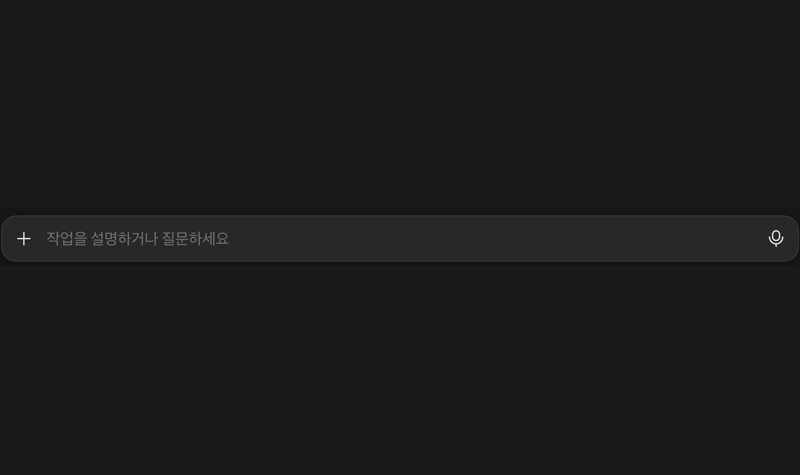

# self-driving: a Claude Code skill

**English** | [한국어](README.ko.md)



> **License: CC BY-NC 4.0 (non-commercial use only).** You may use, modify, and share this for personal and non-commercial purposes with attribution. Commercial use, including selling it or putting it in a paid product or service, is not allowed.

You say *what* you want done. A Claude Code session then drives the Mac itself (opening apps, clicking, typing, recording, building, testing) until the job is finished. It stops and tells you only at the moments a human has to act: automatic safety checks, OS permission dialogs, passwords, payments, and anything that sends something to the outside world.


## When to use it
- Recording an app demo from start to finish
- Handing feature work, tests, and on-screen checks to a second Mac (the "driver Mac")
- Letting the Mac you normally use carry out a planned task while you are away (only when an away-marker file exists)

## Requirements
| What | Why | How to check |
|---|---|---|
| macOS + Claude Code in the Claude desktop app | Where the skill and sessions run | A session opens in the app's Code tab |
| A paid Claude plan | Claude Code access | You are signed in to the app |
| Computer use turned on | Opening apps, clicking, typing | The session lists computer-use tools. Each app asks for permission the first time |
| macOS "Screen Recording" and "Accessibility" permissions | Seeing, controlling, and recording the screen | System Settings → Privacy & Security |
| (Two Macs) Messages between sessions | The supervising session instructs the driver Mac's session | The other session shows up in `ListAgents`, or runs with Remote Control |
| (Two Macs) ssh access | Checking files and processes on the driver Mac, pulling results back | `ssh <driver_ssh> true` works without a password |
| (Recording) A screen recorder | Demo recordings | Any recorder whose process can be quit when done |
| (Driving Claude app windows) Xcode command line tools | Building `tools/drive` | `swiftc --version` works. If not, run `xcode-select --install` |

A single Mac works too. Leave `driver_ssh` empty and the current session drives.

## Recommended setup: bypass mode
self-driving works best with Claude Code in **Bypass permissions** mode. If a tool-permission prompt appears mid-drive, the run sits there until a person clicks it.
- **Use a dedicated driver Mac.** Bypass mode is meant for isolated environments. Because this skill also controls the screen, run it on a separate Mac (or a separate user account), not the Mac you use every day.
- Desktop app: pick "Bypass permissions" in the permission-mode menu under the prompt box.
- Terminal: `claude --dangerously-skip-permissions`

In bypass mode Claude Code runs tools without asking, so **block what must never happen ahead of time.** Anything listed under `permissions.deny` in `~/.claude/settings.json` is refused even in bypass mode. For example:
```json
{
  "permissions": {
    "deny": [
      "Bash(rm -rf:*)",
      "Bash(git push --force:*)",
      "Bash(git reset --hard:*)",
      "Read(./.env*)"
    ]
  }
}
```
- `Bash(...)` patterns are not a complete block. Spelling a command differently (`rm -r -f`) or doing the same thing with another tool gets around them. Block important things at the tool level. `Read(./.env*)` is relative to the working folder and does not cover other folders.
- If you have connectors (MCP tools) that send mail or messages, pay, or delete, put those tool names (`mcp__<server>__<tool>`) in `deny` as well. That is the most reliable block.
- Treat this example as a starting point and extend it for your own tools and work.
- The skill tells the model to stop and notify you at the stop points (passwords, OS permission dialogs, payments, outbound messages, deletion, production deploys). That is the model following instructions. **The only thing that actually enforces a block is the `deny` list**, so anything that must be blocked belongs there.
- The bundled `tools/drive` (Claude app window control) is limited in code to starting one new session with one instruction. It only clicks inside the prompt-box strip of the window it opened itself (matched by window number), and refuses every click and keystroke after sending. So it cannot answer permission prompts or questions from the new session, or change its permission mode or model.
- **Note:** Giving the app that runs Claude Code macOS "Accessibility" permission lets Claude control that app's own windows. The limits in `drive` prevent mistakes; they do not stop deliberately written code from getting around them. Decide on that permission with this in mind.

## Install
```bash
git clone https://github.com/beyondworks/claude-self-driving.git && cd claude-self-driving
bash install.sh
```
- Copies the skill into `~/.claude/skills/self-driving/` and creates `config.json` from the example if it does not exist (an existing one is left alone).
- If a skill with the same name already exists, it is moved to `~/.claude/skills-backup/self-driving.bak-<time>` first, and its `config.json` is carried over.
- Reopen Claude Code or start a new session, and `self-driving` appears in the skill list.

## Configuration (`~/.claude/skills/self-driving/config.json`)
| Field | Value |
|---|---|
| `supervisor_session` | Name of the session that sends instructions (empty = current session) |
| `dispatcher_session` | Session on the driver Mac that hands out work (empty if none) |
| `roles` | Worker session names by kind of work, e.g. `{"recording": "Recorder", "dev": "App dev"}` |
| `driver_ssh` | ssh target for the driver Mac, e.g. `me@192.168.0.20` or an ssh alias. Empty for one Mac |
| `result_dir` | Folder where result files are collected |
| `model` / `effort` | Model and effort level for recording and work (checked before starting) |
| `away_file` | The Mac you use is driven only while this file exists. Leave empty to never drive it |
| `lock_file` | Lock file so only one session holds the screen at a time |

## How it works


## First run
Tell a session:
```
/self-driving Open Calculator, compute 12×34, take a screenshot of the result, and put it in ~/self-driving-results.
```
The session reads the config → checks the lock file → gets computer-use permission (first time only) → opens the app and calculates → saves the screenshot → reports the result and anything that blocked it.

## Safety
- Irreversible actions (payments and purchases, sending mail or messages, public posts and uploads, permanent deletion, production deploys and merges to the default branch) are not done by the skill; it asks a person first.
- Passwords, one-time codes, and OS permission dialogs are always handled by a person.
- When an automatic safety check blocks something, the skill does not work around it another way, such as clicking on screen.
- The Mac you use is controlled only while the away file (`away_file`) exists, and driving stops as soon as the file is gone. Windows you left open are not touched.
- A recording captures everything on screen. Before starting, make sure no mail, notifications, or secrets are visible.

## Uninstall
```bash
rm -rf ~/.claude/skills/self-driving
```

## License
CC BY-NC 4.0: you may use, modify, and share this for non-commercial purposes with attribution; commercial use is not allowed. See `LICENSE` for the full text.
