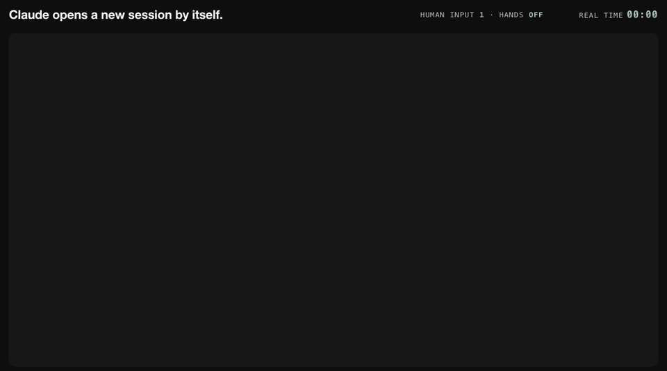
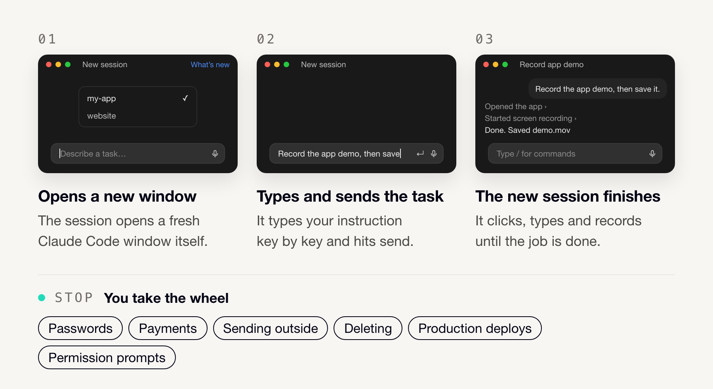

# self-driving: a Claude Code skill

**English** | [한국어](README.ko.md)



> **License: CC BY-NC 4.0 (non-commercial use only).** You may use, modify, and share this for personal and non-commercial purposes with attribution. Commercial use, including selling it or putting it in a paid product or service, is not allowed.

You say *what* you want done. A Claude Code session then drives the Mac itself (opening apps, clicking, typing, recording, building, testing) until the job is finished. It stops and tells you only at the moments a human has to act: automatic safety checks, OS permission dialogs, passwords, payments, and anything that sends something to the outside world.


## How is this different from computer use or browser use?
Computer use and browser use are **tools**. With them, a Claude Code session can already carry out a multi-step task on screen from one prompt, together with the shell. self-driving is a **way of working** built on top of those tools. It adds three things:

| | Computer use / browser use on their own | With self-driving |
|---|---|---|
| Opening new Claude sessions | Not something the tools do | The session opens a new Claude session window by itself and sends it one instruction (`tools/drive`) |
| Where to stop | Whatever you write in your prompt | A fixed list of stop points (see Security), backed by your `deny` rules |
| Recording and collecting results | Up to your prompt | A set routine: one session holds the screen (lock file), recordings are cleaned up, results land in one folder, and blockers are reported |

## What it can do on its own
self-driving lets Claude Code do what Claude Code can already do, without your hands in the loop, except at the stop points: build an app (write code, build, test), operate apps and browsers through computer use and browser use, record the screen for a demo video, and hand pieces of work to new sessions.
- **Verified (the demo above):** on macOS with the Claude desktop app, from the single "Try it" instruction below, one session built a to-do web app, ran 26 browser checks on desktop and phone sizes (all passed), recorded a 30-second demo video, and wrote a test report, with no further human input. Real time: about 15 minutes.
- **Verified:** a session opened a new session window by itself, typed an instruction into its prompt box, sent it, and the new session answered.


## When to use it
- Recording an app demo from start to finish
- Handing feature work, tests, and on-screen checks to a second Mac (the "driver Mac")
- Letting the Mac you normally use carry out a planned task while you are away (only when an away-marker file exists)

## Requirements
| What | Why | How to check |
|---|---|---|
| macOS 14 or later + Claude Code in the Claude desktop app | Where the skill and sessions run | A session opens in the app's Code tab |
| A Pro, Max, or Ultra plan | Computer use is available on these plans, not on Team or Enterprise | You are signed in to the app |
| Computer use turned on | Opening apps, clicking, typing | The session lists computer-use tools. Each app asks for permission the first time |
| macOS "Screen Recording" and "Accessibility" permissions | Seeing, controlling, and recording the screen | System Settings → Privacy & Security |
| (Two Macs) Messages between sessions | The supervising session instructs the driver Mac's session | The other session shows up in `ListAgents`, or runs with Remote Control |
| (Two Macs) ssh access | Checking files and processes on the driver Mac, pulling results back | `ssh <driver_ssh> true` works without a password |
| (Recording) A screen recorder | Demo recordings | Any recorder whose process can be quit when done |
| (Driving Claude app windows) Xcode command line tools | Building `tools/drive` | `swiftc --version` works. If not, run `xcode-select --install` |

A single Mac works too. Leave `driver_ssh` empty and the current session drives.

## Supported environments
| Environment | Status |
|---|---|
| macOS + Claude desktop app (Code tab) | **Supported.** This is the default and the only setup tested. |
| Claude Code in a terminal (macOS) | **Supported for starting new sessions** with `tools/spawn` (below): headless mode tested on macOS; `--visible` not tested. Computer use is also available in the terminal (research preview: enable the built-in `computer-use` server from `/mcp`, once per project; not in `-p` mode); a full self-driving run from the terminal is not tested yet. |
| Claude Code in a terminal on Linux | Not tested. `tools/spawn` headless mode uses only `bash`, `uuidgen`, and `claude`, so it is designed to work; `--visible` and `tools/drive` are macOS only. |
| Windows (and the rest on Linux) | **Not supported yet.** Computer use itself also runs on Windows in the desktop app, but this skill relies on macOS-only parts: `tools/drive` (Swift + CGEvent + the Accessibility API), `osascript`, `screencapture`, `pbcopy`, and the macOS Screen Recording and Accessibility permissions. |

## Recommended setup: bypass mode
self-driving works best with Claude Code in **Bypass permissions** mode. If a tool-permission prompt appears mid-drive, the run sits there until a person clicks it.
- **Use a dedicated driver Mac.** Bypass mode is meant for isolated environments. Because this skill also controls the screen, run it on a separate Mac (or a separate user account), not the Mac you use every day.
- Desktop app: on Pro, Max, or Ultra, first turn on **Settings → Code → Allow bypass permissions mode**, then pick "Bypass permissions" in the permission-mode menu under the prompt box. On Team or Enterprise, your organization's policy decides whether it is available.
- Terminal: `claude --dangerously-skip-permissions` (only for the shell parts; see Supported environments)

In bypass mode Claude Code runs tools without asking, so **block what must never happen ahead of time.** Anything listed under `permissions.deny` in `~/.claude/settings.json` is refused even in bypass mode. For example:
```json
{
  "permissions": {
    "deny": [
      "Bash(rm -rf:*)",
      "Bash(git push --force:*)",
      "Bash(git reset --hard:*)",
      "Read(.env*)"
    ]
  }
}
```
- `Bash(...)` patterns are not a complete block. Spelling a command differently (`rm -r -f`) or doing the same thing with another tool gets around them. Block important things at the tool level. `Read(.env*)` (no path prefix) covers files whose names start with `.env` (`.env`, `.env.local`, `.env.production`) at any depth, but it does not stop shell commands such as `cat .env`.
- If you have connectors (MCP tools) that send mail or messages, pay, or delete, put those tool names (`mcp__<server>__<tool>`) in `deny` as well. That is the most reliable block.
- Treat this example as a starting point and extend it for your own tools and work.
- The skill tells the model to stop and notify you at the stop points (passwords, OS permission dialogs, payments, outbound messages, deletion, production deploys). That is the model following instructions. **The only thing that actually enforces a block is the `deny` list**, so anything that must be blocked belongs there.
- The bundled `tools/drive` (Claude app window control) is limited in code to starting one new session with one instruction. It only clicks inside the prompt-box strip of the window it opened itself (matched by window number; the strip also contains the "+" attach and microphone buttons, which the skill tells the model to avoid), and refuses every click and keystroke after sending. `type` and `enter` bring the Claude app to the front first, and stop if another window comes to the front while typing. So it cannot answer permission prompts or questions from the new session, or change its permission mode or model.
- **Note:** Giving the app that runs Claude Code macOS "Accessibility" permission lets Claude control that app's own windows. The limits in `drive` prevent mistakes; they do not stop deliberately written code from getting around them. Decide on that permission with this in mind.

## Starting new sessions from the terminal: `tools/spawn`
Without the desktop app, the session starts new sessions with `tools/spawn` instead of `tools/drive`. Same scope: it only starts a session with one instruction and never types into, answers, or approves anything afterwards.
```bash
tools/spawn start --dir ~/my-app --name "release notes" -- "Write release notes from this week's git log into NOTES.md, then reply done."
tools/spawn status <id>     # running | done | failed
tools/spawn result <id>     # the new session's final answer
claude --resume <id>        # pick up the conversation yourself
```
- Default is headless (`claude -p`). On macOS, `--visible` opens the session in a new Terminal window instead, so you can watch it.
- `--mode` sets the new session's permission mode (`acceptEdits`, `auto`, `manual`, `plan`); without it, `manual` is passed explicitly, so your settings' `defaultMode` (which may be bypass) is never used. Enforced in code: `bypassPermissions` and `dontAsk` are refused. Model promise only: not starting a session with a wider mode than the caller's own (the tool cannot see the caller's mode). Your `deny` rules apply either way. In headless mode, a tool that needs approval is refused, since nobody is there to approve it.
- The instruction never goes through a shell string, and one that starts with `-` is refused, so text in it can be read neither as a command nor as a `claude` option (tested with `$(...)`, backticks, `--version`, and `--dangerously-skip-permissions`). Headless sessions receive it on standard input.

## Install
```bash
git clone https://github.com/beyondworks/claude-self-driving.git && cd claude-self-driving
bash install.sh
```
- Copies the skill into `~/.claude/skills/self-driving/` and creates `config.json` from the example if it does not exist (an existing one is left alone).
- If a skill with the same name already exists, it is moved to `~/.claude/skills-backup/self-driving.bak-<time>` first, and its `config.json` is carried over.
- Reopen Claude Code or start a new session, and `self-driving` appears in the skill list.

## Configuration (`~/.claude/skills/self-driving/config.json`)
| Field | Value |
|---|---|
| `supervisor_session` | Name of the session that sends instructions (empty = current session) |
| `dispatcher_session` | Session on the driver Mac that hands out work (empty if none) |
| `roles` | Worker session names by kind of work, e.g. `{"recording": "Recorder", "dev": "App dev"}` |
| `driver_ssh` | ssh target for the driver Mac, e.g. `me@192.168.0.20` or an ssh alias. Empty for one Mac |
| `result_dir` | Folder where result files are collected |
| `model` / `effort` | Model and effort level for recording and work (checked before starting) |
| `away_file` | The Mac you use is driven only while this file exists. Leave empty to never drive it |
| `lock_file` | Lock file so only one session holds the screen at a time |

## How it works


## Try it
Give a session a job that would take you half an hour of switching between the editor, terminal, browser, and recorder:
```
/self-driving Build a small to-do web app in ~/my-app, run it, click through every screen in the browser, record a 30-second demo video, and put the video plus a short test report in ~/self-driving-results.
```
What the session does on its own:
1. Read the config and check the lock file, so only one session holds the screen.
2. Write the app in `~/my-app`, install what it needs, build it, and start it locally.
3. Open it in a browser and click through each screen like a first-time user, noting anything broken.
4. Record a 30-second demo with the screen recorder, then quit the recorder.
5. Write a short test report and put it, with the video, in `~/self-driving-results`.
6. Report back what it did and anything that stopped it (for example a first-time computer-use or Screen Recording permission prompt, which a person approves).

Nothing in this example deletes data, sends anything outside, pays, or posts publicly. The demo at the top is a real run of this exact instruction.

## Security: where it stops
Two layers protect you, and they are not equally strong:
- **Enforced block:** `permissions.deny` in `~/.claude/settings.json`. Claude Code refuses these even in bypass mode. This is the only layer that actually blocks.
- **Model promise:** the stop points in `SKILL.md`. The model is told to stop and ask a person. It usually does, but it is an instruction, not a lock.

The `deny` examples below block **only the exact forms they name**. A different spelling of the same command (`rm -fr`, `git push -f`, `git branch --delete --force`) or another tool doing the same thing gets past them. Add the variants you care about, and block whole tools where you can.

| Stop point | Enforced block (`deny` example, partial) | Model promise (`SKILL.md`) |
|---|---|---|
| Permanent deletion of files or data (`rm -rf`, emptying the Trash, forced git reset, force push, force-deleting branches) | `Bash(rm -rf:*)`, `Bash(rm -fr:*)`, `Bash(git reset --hard:*)`, `Bash(git push --force:*)`, `Bash(git push -f:*)`, `Bash(git branch -D:*)`, and the delete tools of your connectors. Emptying the Trash has no simple rule. | Never deletes permanently; asks first |
| Exporting secrets (reading or printing `.env`, keys, tokens, passwords, or sending them anywhere) | `Read(.env*)`, plus `Read(...)` rules for your key and token files. These do not stop shell commands such as `cat .env`. | Never reads, prints, or sends secret values |
| Messages people receive (sending, replying to, or forwarding mail; chat messages; calendar invites) | The send, reply, forward, and invite tools of your mail, chat, and calendar connectors (`mcp__<server>__<tool>`) | Drafts only; a person sends |
| Payments, purchases, transfers, accepting contracts or terms | The payment tools of your connectors | Stops; a person decides |
| Public posting (social media, app store releases, public uploads) | The publish and post tools of your connectors | Stops; a person publishes |
| Passwords, one-time codes, two-factor prompts, OS permission dialogs | Not blockable by `deny`; macOS asks the person | Never types them; a person handles them |
| Getting around an automatic safety check another way (for example by clicking on screen) | Not blockable by `deny` | Never works around a block; reports it instead |
| Production deploys and merges to the default branch | Your deploy and merge commands or tools | Prepares and reports; a person approves |

Also:
- Model promises, not enforced: the skill tells the session to drive the Mac you use only while the away file (`away_file`) exists, to check it at every step and stop once it is gone, and to work only in windows it opened. Note that computer use itself hides other apps' windows while it works and restores them afterwards.
- A recording captures everything on screen. Before starting, make sure no mail, notifications, or secrets are visible.

## Uninstall
```bash
rm -rf ~/.claude/skills/self-driving ~/.claude/self-driving-drive.json ~/.claude/self-driving-spawn
rm -rf ~/.claude/skills-backup/self-driving.bak-*(N)   # zsh; in bash use: rm -rf ~/.claude/skills-backup/self-driving.bak-*
```

## License
CC BY-NC 4.0: you may use, modify, and share this for non-commercial purposes with attribution; commercial use is not allowed. See `LICENSE` for the full text.
